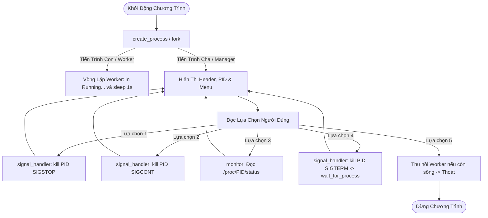

# Process Management System – Suspend / Resume Process using Signal

> **Đồ Án Môn Học:** Lập trình hệ thống (System Programming)  
> **Ngôn ngữ:** C (C11, POSIX Standard)  
> **Nền tảng:** Ubuntu Linux / GCC / Make  

---

## 1. Project Introduction (Giới Thiệu Dự Án)

Dự án **Process Management System** là một ứng dụng quản lý tiến trình chuyên biệt chạy trên môi trường Linux Terminal. Chương trình được thiết kế nhằm mục đích nghiên cứu và thực hành chuyên sâu về các khái niệm cốt lõi trong **Lập trình hệ thống (System Programming)**:
- Quản lý vòng đời tiến trình (*Process Lifecycle*): tạo tiến trình con (Worker process) bằng lời gọi hệ thống `fork()`.
- Điều khiển tiến trình bằng các tín hiệu chuẩn của Linux (*Signals*): tạm dừng (`SIGSTOP`), tiếp tục (`SIGCONT`), và kết thúc tiến trình an toàn (`SIGTERM`).
- Giám sát trạng thái tiến trình thời gian thực thông qua cơ chế hạt nhân ảo Linux `/proc/<PID>/status`.
- Giao diện dòng lệnh tương tác trực quan (Interactive Terminal Menu) có cơ chế phòng chống lỗi và kiểm soát tài nguyên chặt chẽ.

---

## 2. Features (Tính Năng Nổi Bật)

- **Tạo Worker Process độc lập:** Sử dụng `fork()` để tạo một tiến trình con thực thi vòng lặp tác vụ ngầm, định kỳ xuất thông tin và không gây tốn CPU (`sleep(1)`).
- **Điều khiển tín hiệu theo thời gian thực:**
  - **Suspend:** Tạm dừng tiến trình tức thời với tín hiệu `SIGSTOP`.
  - **Resume:** Kích hoạt tiến trình tiếp tục chạy từ điểm dừng với `SIGCONT`.
  - **Terminate:** Kết thúc tiến trình sạch sẽ với `SIGTERM`.
- **Giám sát trạng thái thực tế từ Kernel:** Đọc trực tiếp file `/proc/<PID>/status` của Linux để hiển thị chính xác các trạng thái: `RUNNING`, `STOPPED`, `TERMINATED`, `UNKNOWN`.
- **Chống tiến trình mồ côi và Zombie:** Cơ chế thu hồi tài nguyên thông qua `waitpid()` khi tiến trình con kết thúc hoặc khi thoát chương trình.
- **Xử lý lỗi toàn diện (Robust Error Handling):** Ngăn ngừa crash khi người dùng nhập dữ liệu không hợp lệ (chuỗi ký tự, số âm, số ngoài dải menu), và kiểm tra hợp lệ của PID trước khi gửi tín hiệu.

---

## 3. Technologies (Công Nghệ Sử Dụng)

- **Ngôn ngữ:** C (chuẩn C11)
- **Chuẩn API:** POSIX.1-2008 (`unistd.h`, `signal.h`, `sys/wait.h`, `sys/types.h`)
- **Trình biên dịch:** GCC (`gcc` version >= 9.x)
- **Hệ thống Build:** GNU Make
- **Hệ điều hành mục tiêu:** Ubuntu Linux (hỗ trợ WSL2, Ubuntu Desktop/Server)
- **Quản lý phiên bản:** Git & GitHub

---

## 4. Project Structure (Cấu Trúc Thư Mục)

```text
process-management-signal/
│
├── src/
│   ├── main.c              # Hàm main tích hợp, vòng lặp điều khiển chính
│   ├── process_manager.c   # Quản lý tiến trình (fork, alive check, wait)
│   ├── process_manager.h   # Header khai báo API quản lý tiến trình
│   ├── signal_handler.c    # Quản lý tín hiệu (SIGSTOP, SIGCONT, SIGTERM)
│   ├── signal_handler.h    # Header khai báo API tín hiệu
│   ├── monitor.c           # Giao diện menu, parser input, đọc /proc status
│   └── monitor.h           # Header khai báo API monitor
│
├── tests/
│   ├── test_process.sh     # Kiểm thử tạo tiến trình và chạy Worker
│   ├── test_signal.sh      # Kiểm thử gửi tín hiệu Suspend/Resume/Terminate
│   └── test_invalid_pid.sh # Kiểm thử xử lý lỗi PID và menu input
│
├── docs/
│   ├── test_cases.md       # Báo cáo chi tiết 10 kịch bản kiểm thử
│   └── screenshots/        # Ảnh chụp màn hình kết quả chạy và kiểm thử
│
├── Makefile                # Kịch bản biên dịch dự án (all, run, clean)
├── README.md               # Tài liệu tổng quan dự án
└── .gitignore              # Danh sách loại trừ cho Git
```

---

## 5. How It Works (Nguyên Lý Hoạt Động)



---

## 6. Signals Used (Các Tín Hiệu Sử Dụng)

| Tín Hiệu | Mục Đích | Giải Thích Chi Tiết |
|:---|:---|:---|
| **`SIGSTOP`** | **Suspend** | Tạm dừng tức thì tiến trình con mục tiêu. Tín hiệu này được Linux Kernel xử lý trực tiếp và tiến trình con không thể bỏ qua (*cannot be caught, blocked, or ignored*). Trạng thái tiến trình chuyển sang `STOPPED` (ký hiệu `T` trong `/proc/<PID>/status`). |
| **`SIGCONT`** | **Resume** | Đánh thức tiến trình con đã bị tạm dừng trước đó tiếp tục thực thi các chỉ thị tiếp theo. Trạng thái chuyển lại thành `RUNNING` (ký hiệu `S`/`R`). |
| **`SIGTERM`** | **Terminate** | Tín hiệu yêu cầu kết thúc tiến trình một cách lịch sự, cho phép dọn dẹp tài nguyên trước khi tiến trình kết thúc. Sau khi gửi, tiến trình cha gọi `waitpid()` để thu hồi bảng ghi tiến trình (*prevent zombie process*). |

---

## 7. Build (Biên Dịch)

Dự án sử dụng file `Makefile` tiêu chuẩn với cờ biên dịch bảo đảm an toàn mã nguồn:

```bash
# Biên dịch project
make
```

Để xóa các file thực thi đã biên dịch:

```bash
# Dọn dẹp bản dựng
make clean
```

---

## 8. Run (Chạy Chương Trình)

Để chạy chương trình trực tiếp sau khi biên dịch:

```bash
./process_manager
```

Hoặc sử dụng mục tiêu có sẵn trong Makefile:

```bash
make run
```

---

## 9. Test (Kiểm Thử Tự Động)

Hệ thống đi kèm bộ kiểm thử tự động toàn diện được viết bằng Bash Script:

```bash
# Cấp quyền thực thi nếu cần
chmod +x tests/*.sh

# 1. Kiểm thử vòng đời Worker Process
./tests/test_process.sh

# 2. Kiểm thử bộ điều khiển tín hiệu (Suspend, Resume, Terminate, lặp tín hiệu)
./tests/test_signal.sh

# 3. Kiểm thử khả năng chịu lỗi đối với PID và input không hợp lệ
./tests/test_invalid_pid.sh
```

Chi tiết kịch bản và kết quả kiểm thử được lưu trữ tại [`docs/test_cases.md`](docs/test_cases.md).

---

## 10. Team Structure (Cơ Cấu Nhóm Dự Án)

- **Leader:** Đảm nhiệm kiến trúc tổng thể, quản trị Git/GitHub, tích hợp hệ thống (`main.c`).
- **Thành viên 2:** Phụ trách Module 1 - Process Management (`src/process_manager.c`, `src/process_manager.h`).
- **Thành viên 3:** Phụ trách Module 2 - Signal Control (`src/signal_handler.c`, `src/signal_handler.h`).
- **Thành viên 4:** Phụ trách Module 3 & 4 - Terminal UI / Monitor & Testing (`src/monitor.c`, `src/monitor.h`, `tests/`).
